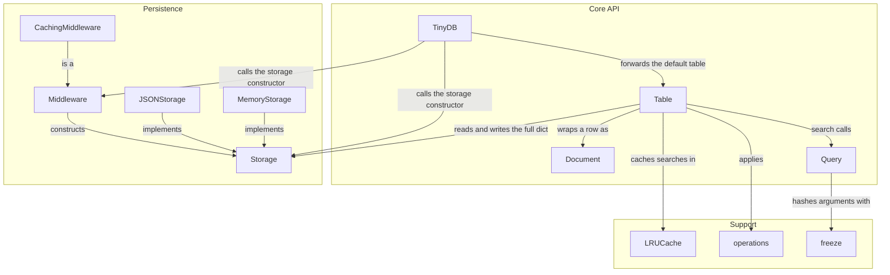

# TinyDB architecture

This note describes TinyDB at commit `edff96a` (version 4.9.0). It is about how the pieces fit together, not about how to call them from an application.

## 1. Overview

TinyDB is a single-process document store. A document is a mapping. The database keeps every table in one nested dictionary and asks a storage object to read and write that dictionary as a whole. There is no query engine process and no separate schema.

Six components do the work.

| Component | File | Role |
| --- | --- | --- |
| TinyDB | `tinydb/database.py` | Owns the storage instance and the open tables. Forwards unknown attributes to the default table. |
| Table and Document | `tinydb/table.py` | Inserts, updates, removes and searches one table. Allocates integer document ids and caches search results. |
| Query | `tinydb/queries.py` | Builds tests against one document. Does not know about tables or storage. |
| Storage | `tinydb/storages.py` | Abstract persistence. `JSONStorage` writes a JSON file. `MemoryStorage` keeps the dict in memory. |
| Middleware | `tinydb/middlewares.py` | Wraps a storage class. `CachingMiddleware` buffers writes and flushes them later. |
| Operations and utils | `tinydb/operations.py`, `tinydb/utils.py` | Update helpers (`set`, `delete`, `increment`, …) and the LRU query cache plus `freeze`, which makes query arguments hashable. |

`mypy_plugin.py` only teaches MyPy about a typing helper. It is not on the read or write path.

### Who calls whom

`TinyDB.__init__` pops the `storage` keyword and calls whatever remains as a constructor: `storage(*args, **kwargs)`. The default class is `JSONStorage`. Every other argument, including the file path, is forwarded to that constructor.

A caller who wants a named table uses `db.table(name)`. Any other attribute or method, and `len(db)` and iteration, go to the table named `_default`. The table registry is a plain dict of table instances that have already been opened.

`Table` never writes a single document on its own. `_update_table` reads the whole database, edits one table in memory, writes the whole database back, and then clears the query cache. Search reads the table and tests each raw document with the query object.

`Query` is a builder. Comparing, matching, or calling `one_of` returns a `QueryInstance`. Calling that instance on one document returns true or false. `Table.search` is what walks the rows. `operations.py` does not import the rest of the package. `Table.update` calls those helpers on a document dict.

Middleware sits in the storage slot. `CachingMiddleware(JSONStorage)` is an instance, not a storage class. TinyDB still calls it. `Middleware.__call__` constructs the wrapped class and returns the middleware, so from then on `read`, `write` and `close` hit the wrapper.



### The dictionary that storage sees

The object passed to `Storage.write`, and later returned by `Storage.read`, looks like this:

```text
{
  "_default": {
    "1": {"name": "Ada"},
    "2": {"name": "Grace"}
  },
  "other": {
    "1": {"n": 1}
  }
}
```

The outer keys are table names. The inner keys are document ids. In the stored dict those ids are strings, because JSON object keys are strings. In the public API they are ints. `Table._update_table` converts them on the way in and back to strings on the way out. `Table.get(doc_id=...)` looks the id up with `str(doc_id)` on the raw table. An empty file, and a memory storage that has never been written, reads as `None`. `Table` treats `None` as "no tables yet".

### Queries and the cache

A query path is a tuple of field names. `_generate_test` walks that path and returns false if a step raises `KeyError` or `TypeError`, so a missing field does not escape the query. The test then sees only the value at the end of the path.

Cacheable queries carry a hash tuple. `__eq__` stores `('==', path, freeze(rhs))`. `matches` stores the pattern and the regex flags, so two patterns that differ only by flags do not share a cache entry. `freeze` turns lists into tuples and dicts into a hashable `FrozenDict`. If the arguments cannot be hashed, the query is marked uncacheable instead of raising.

`Table.search` checks an `LRUCache` before scanning. The default capacity is 10. A hit returns a shallow copy of the cached list. A miss scans, and the result is stored only when `is_cacheable()` is true. Any successful `_update_table` calls `clear_cache()`.

## 2. Decision records

### ADR-001. A storage is passed as a class, and middleware is a callable wrapper

Status: Verified.

Context. TinyDB has to create the storage itself, because it owns the path and the other constructor arguments. Middleware needs a chance to construct the real storage at that same moment, and wrappers need to nest.

Decision. Callers pass a storage class, or a middleware instance created with a storage class: `TinyDB(path, storage=CachingMiddleware(JSONStorage))`. `TinyDB.__init__` always does `storage(*args, **kwargs)`. `Middleware.__init__` stores the class. `Middleware.__call__` does `self.storage = self._storage_cls(*args, **kwargs)` and returns the middleware.

Alternatives. Pass an already constructed storage instance. That works for a bare `MemoryStorage()` only if the constructor takes no path, and it breaks the middleware shape, because the wrapper would have to hold an object it did not build. The comment on `Middleware.__call__` contrasts the two shapes and explains why the wrapper must be what TinyDB calls. A free function registered under another keyword was not used. There is one `storage` parameter.

Consequences. A new backend is a class whose constructor accepts the same forwarded arguments as `JSONStorage`, including the path. A middleware is written against `Middleware` and receives a class, not a live file handle. `CachingMiddleware` depends on that: it forwards reads and writes to `self.storage` and flushes on `close`.

Evidence. `tinydb/database.py:92` and `tinydb/database.py:95`. `tinydb/middlewares.py:21` stores the class. `tinydb/middlewares.py:25` through `tinydb/middlewares.py:65` is the comment and the `__call__` implementation.

### ADR-002. Document ids are ints in the API and strings in storage

Status: Verified.

Context. Callers use integer ids, starting at 1. The default storage is JSON, and JSON object keys are strings. `MemoryStorage` stores the same dict the JSON storage would, because both receive whatever `Table` writes.

Decision. `document_id_class` is `int`. On every update the table casts stored keys with that class, runs the mutation, then writes `str(doc_id)` back. The next id is one more than the current maximum, or 1 when the table is empty.

Alternatives. Keep Python ints in the stored dict. `JSONStorage` would coerce them to strings on dump and they would come back as strings, so the in-memory and on-disk forms would disagree. Store rows in a list and treat the index as the id. That makes deletion renumber rows, which the current `remove` does not do. Ids are stable and are not reused by `_get_next_id` once issued, except when the caller inserts a `Document` that already has an id.

Consequences. Storage implementations should round-trip the nested dict they are given. They should not renumber keys or cast them back to ints. `get`, `contains`, `update` and `remove` agree only because this conversion happens in one place, `_update_table`, and the raw read path uses `str(doc_id)`. While a table object is alive, `_next_id` stays ahead of ids already handed out. After the process opens the table again, the next id is one more than the largest id still in the stored dict.

Evidence. The conversion and the comment that names JSON keys are in `tinydb/table.py:830` through `tinydb/table.py:848`. The raw lookup is `tinydb/table.py:363`. The id class default is `tinydb/table.py:82`.

### ADR-003. Search results are cached by a stable query hash

Status: Verified.

Context. A search walks every document. The same query object is often used again, and writes are less common than reads in the cases the cache is aimed at. A cache key has to be stable for the life of the process. Python's default hash is not stable for a query built out of lambdas, lists and dicts.

Decision. `QueryInstance` stores an explicit hash tuple and uses it for `__hash__` and `__eq__`. Mutable arguments go through `freeze`. `Table` keeps an LRU of those queries and throws the whole cache away after a write. Queries that cannot be hashed set the hash to `None`, `is_cacheable` returns false, and `search` does not store them. Custom queries are assumed cacheable unless they say otherwise.

Alternatives. Do not cache. The table docstring describes the cache as an optimisation, so correctness cannot depend on it being enabled, but the default is to cache. Cache by the source text of a lambda. Lambdas have no useful source once built, and two different tests can share a line. Deep-copy every document on the way into the cache. The implementation instead returns a new list and documents that the document objects are shared with the cache.

Consequences. Two queries that match different rows must not compare equal. Their hash tuples have to include every argument that changes the match, not only the field path. A write path that forgets `clear_cache` would serve stale rows. A read path that mutates a cached document corrupts a later search. New query tests should go through `_generate_test` so the path walk and the hash handling stay in one place.

Evidence. The cache contract is the docstring on `Table` at `tinydb/table.py:42` through `tinydb/table.py:50`, and the lookup is `tinydb/table.py:265`. The cacheable check is `tinydb/table.py:291` through `tinydb/table.py:295`. The hash tuple for equality is `tinydb/queries.py:262` through `tinydb/queries.py:265`. `matches` includes the flags at `tinydb/queries.py:358` through `tinydb/queries.py:360`, with a comment that names the cache collision this avoids. `freeze` is `tinydb/utils.py:150`.

## 3. Constraints

1. A new storage subclasses `Storage` and implements `read` and `write`. `read` returns `None` when there is nothing stored yet. `close` may be a no-op. Seen at `tinydb/storages.py:36` (`Storage`), `tinydb/storages.py:79` (`JSONStorage` subclasses it) and `tinydb/storages.py:131` through `tinydb/storages.py:134` (empty file returns `None`).

2. Whatever is passed as `storage` must be callable with the forwarded constructor arguments. A middleware is constructed with a storage class and only then called by TinyDB. Seen at `tinydb/database.py:95` and `tinydb/middlewares.py:63`.

3. `queries.py` does not import `table.py`. The dependency points the other way: `table.py` imports `QueryLike`. Seen at `tinydb/queries.py:19` through `tinydb/queries.py:23` and `tinydb/table.py:15`. Query tests belong in `tinydb/queries.py`, whose module docstring says it contains the querying interface.

4. A cacheable query's hash includes the path and the arguments that change which rows match. `__eq__` freezes the right-hand side. `matches` includes the flags as well as the pattern. `Table.search` stores a result only when the query is cacheable, and `_update_table` clears the cache after a write. Seen at `tinydb/queries.py:264`, `tinydb/queries.py:360`, `tinydb/table.py:291` and `tinydb/table.py:854`.

5. Do not add a runtime dependency. The `[project]` table in `pyproject.toml` (lines 1–31) declares none. `dependency-groups.dev` lists test tools only. Storage and query code in the tree uses the Python standard library. A change that needs a third-party package breaks that constraint. The stored value is still the table dict from ADR-002. A storage that changes that shape, or that changes how `JSONStorage.write` serialises plain JSON, breaks every existing file.
