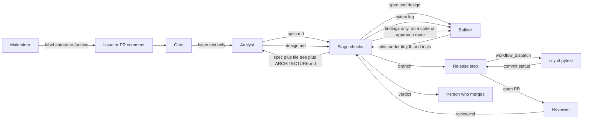

# Component view

Committed before any agent code. This is the design the workflow is built from.

The system has three model roles and one harness. The harness is ordinary Python and GitHub Actions. It is not a model. It owns the trigger, the stage checks, the test command, the pull request, and the token. A model never chooses the next stage and never holds a GitHub credential.

## What each part may use

| Part | Model | May read | May change | Credential |
| --- | --- | --- | --- | --- |
| Gate | none | event payload, collaborator permission | an issue comment, the running label | `GITHUB_TOKEN`, issues write |
| Analyst | `claude-haiku-4-5` | stage 1: the issue and the A1 skill. Stage 2: `spec.md`, `ARCHITECTURE.md`, a path-and-symbol tree | nothing in the git tree | API token in the analyst step only |
| Builder | `claude-sonnet-4-6` | `spec.md`, `design.md`, files under `tinydb/` and `tests/`, pytest output on a retry, `review.md` only during rework | files under `tinydb/` and `tests/` | API token. No `GITHUB_TOKEN` |
| Checks | none | the artifact just produced, and the tree | nothing | none |
| Release | none | branch name, issue number | pushes the issue branch, opens a PR, dispatches CI | `GITHUB_TOKEN` |
| CI | none | the commit being tested | a commit status `ci/pytest` | `GITHUB_TOKEN` |
| Reviewer | `claude-sonnet-4-5` | issue text, the diff, the PR head, pytest output the harness just ran | nothing | API token. Job token is `contents: read` and `pull-requests: write`, used by the harness to post the review, not by the model |
| Person | none | the PR | merge or close | their own |

The analyst is one role with two prompts. The requirements prompt cannot see the source. The design prompt cannot see the requirements conversation, only `spec.md`.

The builder is the only writer. The reviewer is a different job, a different model id, and a different prompt file. Stage 5 has no model.

## Call direction

The Actions workflow calls the harness. The harness calls a model and then a check. Models do not call each other and do not call `gh`. The only loop a model sits inside is the builder's tool loop, and that loop is capped in `workflow/agent`. Going back to an earlier stage is a job in the workflow file, started from a check output, not from a sentence in the model's reply.
