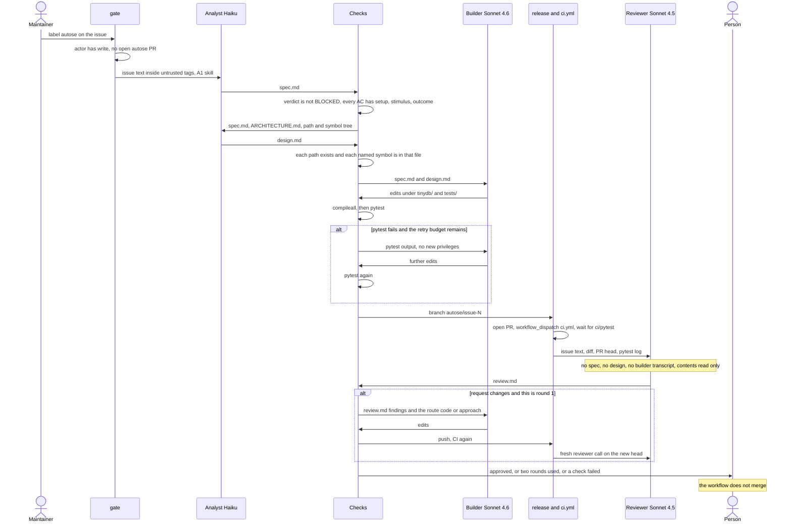

# Sequence view

This is the sequence the workflow implements. A later commit adds the link to one real run at the bottom. The shape below was fixed before the agent code existed.

Happy path for a bug report. The vague issue is the same sequence and stops at the requirements check.

## Where a run stops

| Check that failed | What is saved | What happens next |
| --- | --- | --- |
| Requirements, including a `BLOCKED` verdict | `spec.md` with the reason | The run stops. No branch |
| Design | `design.md` with the checker errors | The run stops. No branch |
| Build, after the test retry and one design retry | `diff.patch`, `test_report.md` | The run stops. No pull request |
| CI | `pr.md` and the failing status | The run stops before review |
| Review round 2 still requests changes | `review.md` | The run stops. The PR stays open |

A model that asks to skip a check has no job it can start. The workflow file is the only place those edges exist.
